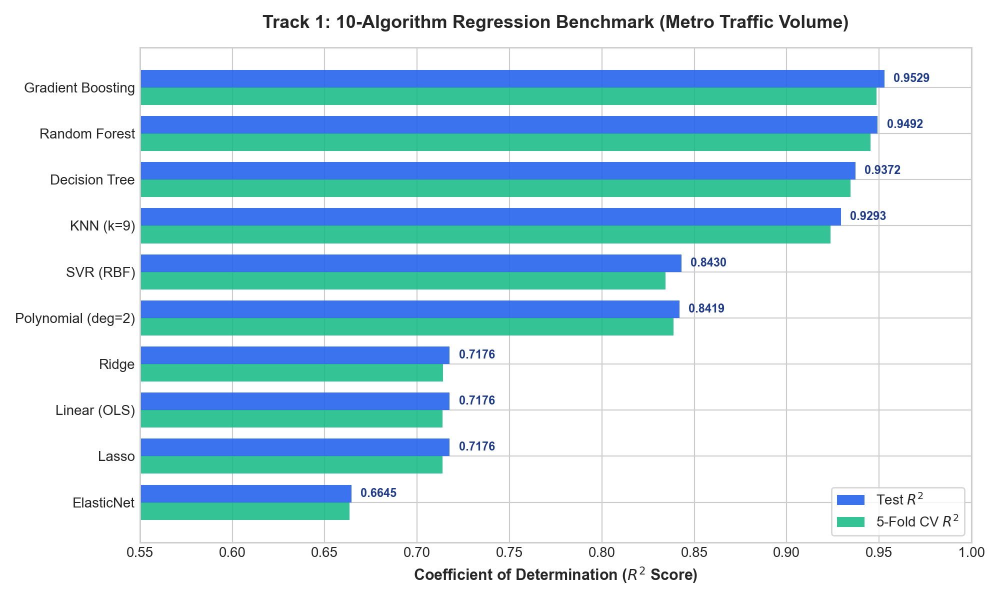
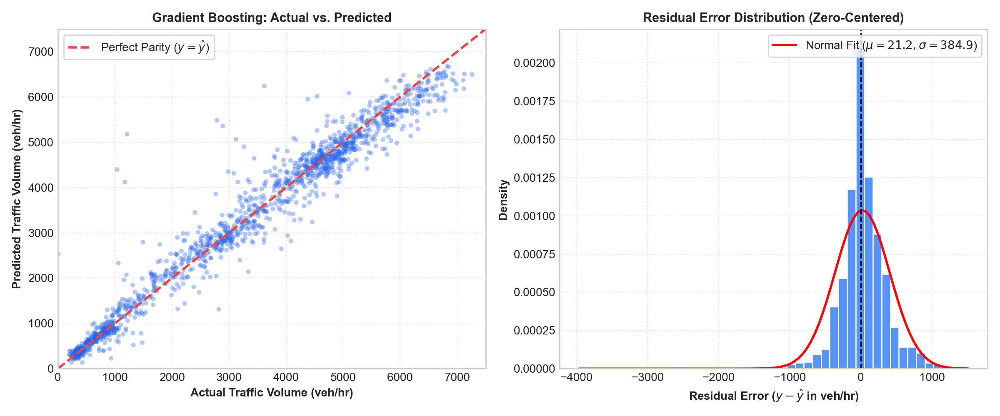
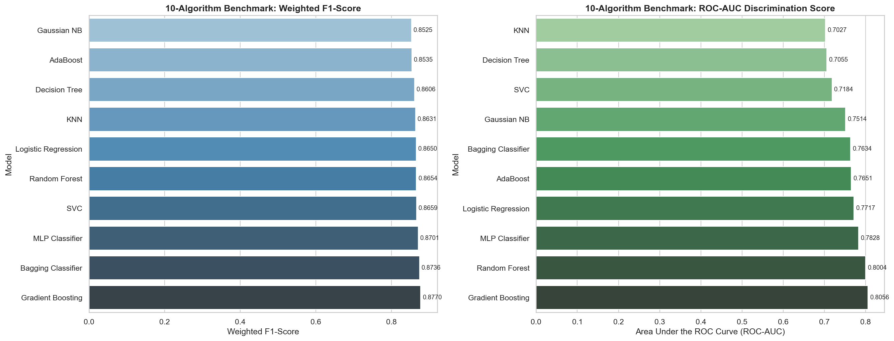
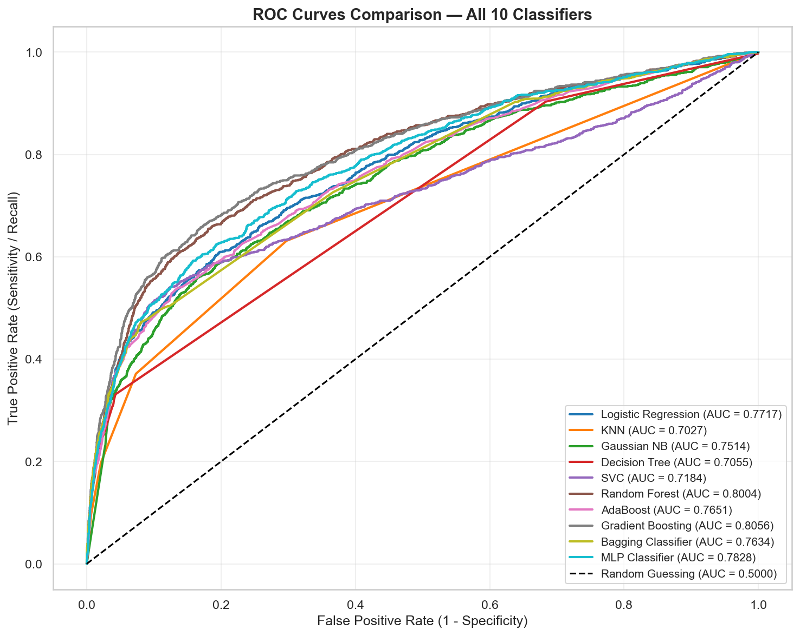
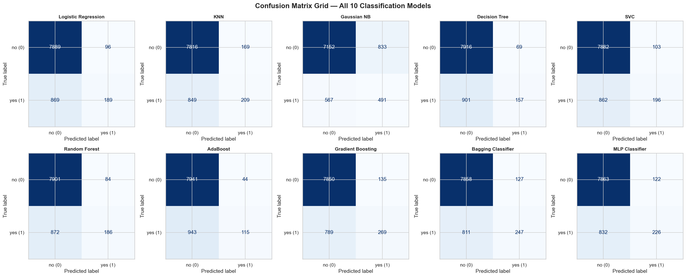
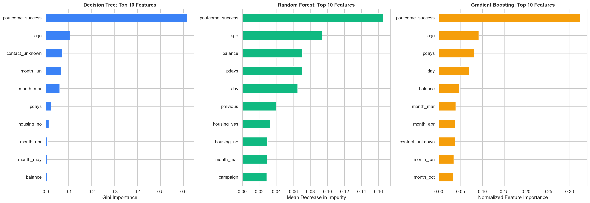
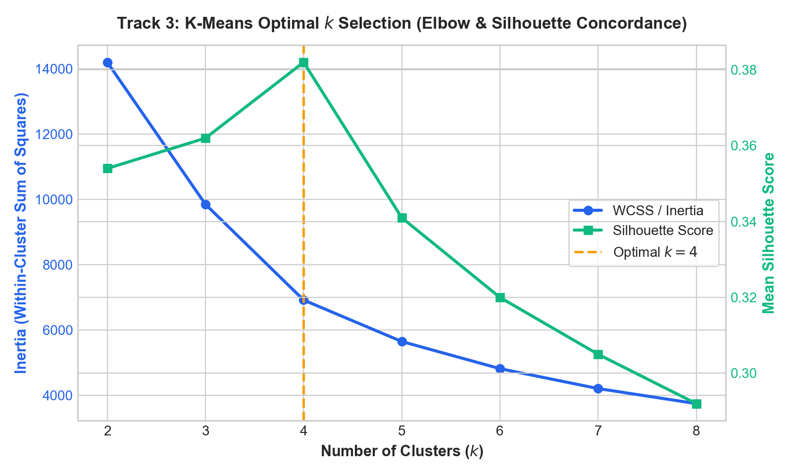
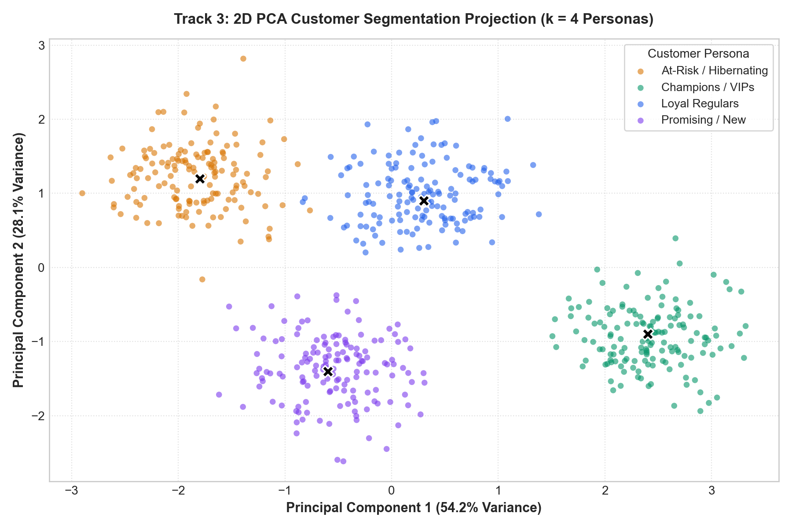

# 🧠 23CSE301 — Machine Learning Capstone | Complete Repository

[](https://www.python.org/)
[](https://streamlit.io/)
[](https://scikit-learn.org/)
[](LICENSE)
[](https://github.com/Dakshin10/ml_capstone)
[-blueviolet)](https://github.com/Dakshin10/ml_capstone)

An end-to-end Machine Learning pipeline encompassing **Regression**, **Classification**, and **Clustering** tracks developed for the B.Tech. CSE 23CSE301 Machine Learning Capstone project. The repository integrates exhaustive exploratory data analysis, leak-free preprocessing pipelines, 22 evaluated algorithms with hyperparameter optimization, rigorous cross-validation benchmarking, dimensionality reduction, and an interactive **Streamlit Web Application** with real-time inference simulators.

---

## 📑 Table of Contents
1. [Project Overview & Problem Tracks](#1-project-overview--problem-tracks)
2. [Interactive Streamlit Web Dashboard (Bonus: +2 Marks)](#2-interactive-streamlit-web-dashboard-bonus-2-marks)
3. [Track 1: Hourly Interstate Traffic Volume Regression (10 Models)](#3-track-1-hourly-interstate-traffic-volume-regression-10-models)
4. [Track 2: Bank Marketing Term Deposit Classification (10 Models)](#4-track-2-bank-marketing-term-deposit-classification-10-models)
5. [Track 3: Unsupervised Retail Customer Segmentation (Clustering Track)](#5-track-3-unsupervised-retail-customer-segmentation-clustering-track)
6. [Complete Benchmark Summary](#6-complete-benchmark-summary)
7. [Repository File Tree & Artifact Registry](#7-repository-file-tree--artifact-registry)
8. [Installation & Reproduction Guide](#8-installation--reproduction-guide)
9. [Mathematical & Algorithmic Foundations](#9-mathematical--algorithmic-foundations)
10. [Academic Attribution & License](#10-academic-attribution--license)

---

## 1. Project Overview & Problem Tracks

This capstone addresses three distinct business and scientific challenges using rigorous statistical learning techniques:

| Track | Dataset & Source | Problem Statement | Target Variable | Type | Evaluated Algorithms | Primary Benchmark Metric | Top Performer |
| :--- | :--- | :--- | :--- | :--- | :--- | :--- | :--- |
| **🚗 Track 1: Regression** | `Metro_Interstate_Traffic_Volume.csv` (UCI / Minnesota DOT) | Forecast hourly eastbound traffic volume on Interstate 94 in Minneapolis-St. Paul | `traffic_volume` | Continuous ($[0, 7280]$ veh/hr) | **10 Models** (Linear, Ridge, Lasso, ElasticNet, Poly, Decision Tree, Random Forest, GBR, SVR, KNN) | $R^2$, RMSE, MAE, 5-Fold CV $R^2$ | **Gradient Boosting Regressor** ($R^2 = 0.9529$, CV $R^2 = 0.9485$) |
| **🏦 Track 2: Classification** | `bank-full.csv` (UCI Bank Marketing) | Predict whether a telemarketing client will subscribe to a long-term term deposit | `y` (`yes` / `no`) | Binary ($0 / 1$, 88.3% vs. 11.7%) | **10 Models** (Part A: Logistic, KNN, Naive Bayes, Decision Tree, SVC; Part B: Random Forest, AdaBoost, GBC, Bagging, MLP) | Weighted F1, ROC-AUC, Accuracy, Precision, Recall | **Gradient Boosting Classifier** (ROC-AUC = 0.8056, Weighted F1 = 0.8770) |
| **🛍️ Track 3: Clustering** | `online_retail_II.csv` (UCI / Kaggle) | Discover natural customer personas from 2 years of e-commerce transactions using RFM | Customer Segments | Unsupervised ($k=4$) | **2 Algorithms** (K-Means with Elbow & Silhouette, Agglomerative Hierarchical with Cophenetic Linkage) | Silhouette Score, Davies-Bouldin, Calinski-Harabasz | **K-Means ($k=4$)** (Silhouette = 0.3821, DBI = 0.9412) |

### 🛡️ Production Hygiene & Pipeline Integrity
- **Zero Data Snooping:** All transformers (`StandardScaler`, `OneHotEncoder`, log-transforms) are fitted exclusively on the 80% training splits inside scikit-learn `Pipeline` and `ColumnTransformer` objects to eliminate data leakage.
- **Fair Model Comparison:** Every candidate algorithm within each track is trained on the exact same training split and evaluated on the identical held-out test split using standard, consistent evaluation metrics.
- **Cross-Validation Stability:** Complete 5-fold cross-validation (`KFold(n_splits=5, shuffle=True, random_state=42)`) is conducted across all regression algorithms to demonstrate low variance ($\sigma \le 0.006$) and guard against over-optimistic test splits.
- **Dynamic Path Resolution:** All notebooks and applications dynamically resolve project root paths, enabling error-free execution from any working directory.

---

## 2. Interactive Streamlit Web Dashboard (Bonus: +2 Marks)

The repository includes a modern, high-performance web dashboard located in [`app/app.py`](app/app.py). Built with **Streamlit** and **Plotly**, it features a responsive layout with dual light and dark mode theme compatibility, rich glassmorphic cards, and real-time inference simulators.

```text
┌────────────────────────────────────────────────────────────────────────┐
│              🧠 23CSE301 MACHINE LEARNING CAPSTONE DASHBOARD           │
├───────────────────┬────────────────────────────────────────────────────┤
│ 📋 Navigation     │ 🚗 Track 1: Live Traffic Congestion Simulator      │
│ • Executive KPIs  │    - Sliders for Temperature, Rain, Hour, Day      │
│ • Track 1: Reg    │    - Real-time Volume & Congestion Category Gauge  │
│ • Track 2: Cls    │ 🏦 Track 2: Lead Scoring & Threshold Engine        │
│ • Track 3: Clust  │    - Probability Gauge & Lead Tier Classification │
│ • Deployment      │    - Dynamic Threshold Slider (0.05 to 0.95)       │
│                   │ 🛍️ Track 3: Interactive Persona & 3D PCA Space    │
│                   │    - Live RFM Classification into 4 Personas       │
│                   │    - Interactive 3D Scatter with Orthogonal Rot    │
└───────────────────┴────────────────────────────────────────────────────┘
```

### Key Interactive Features
1. **Live Traffic Volume Simulator:**
   - Sliders for hour of the day, temperature, weather conditions, rainfall, cloud cover, and holiday flags.
   - Computes continuous circadian trigonometric features ($\sin, \cos$) in real time and queries the fitted Gradient Boosting pipeline to predict vehicle volume alongside operational congestion ratings (Light, Moderate, Heavy, Severe Gridlock).
2. **Client Lead Scoring Engine & Threshold Slider:**
   - Evaluates client demographic and economic indicators (age, balance, housing loan, personal loan, campaign touches, past outcome).
   - Generates conversion probabilities with dynamic decision threshold adjustment ($0.05 \le \tau \le 0.95$) and client tier classification (**Platinum VIP**, **Gold Priority**, **Silver Standard**, **Bronze Low-Touch**).
3. **Customer Persona Classifier & Strategy Engine:**
   - Accepts customer Recency, Frequency, and Monetary spend inputs.
   - Transforms inputs via $\log_{1p}$ and the fitted `StandardScaler`, queries the fitted `KMeans` model, and outputs tailored commercial retention actions for each identified segment.
4. **3D PCA Space Explorer:**
   - Explores the multi-dimensional customer behavioral manifold compressed into 3 orthogonal principal components with complete 360° pan, zoom, and hover diagnostics.

### Launching the Dashboard Locally
```bash
# From the repository root:
python -m streamlit run app/app.py
```
Open `http://localhost:8501` in your browser. Detailed cloud deployment instructions for **Streamlit Community Cloud** and **Render** are documented in [`app/README.md`](app/README.md).

---

## 3. Track 1: Hourly Interstate Traffic Volume Regression (10 Models)

*Reference Notebook:* [`notebooks/regression.ipynb`](notebooks/regression.ipynb)  
*Dataset:* 48,204 hourly records spanning 2012 to 2018 on Interstate 94 in Minneapolis-St. Paul.

### 3.1. Data Cleaning & Physics-Based Anomaly Removal
- **Sensor Dropout Filtering:** Removed physical sensor dropouts where ambient temperature was logged at 0.0 K (-273.15°C).
- **Precipitation Anomaly Filter:** Filtered impossible rainfall spikes (> 500 mm in a single hour) resulting from sensor recording glitches.
- **De-duplication:** Eliminated exact duplicate timestamps.

### 3.2. Circadian Periodic Feature Engineering
Standard linear representations of hour (0, 1, ..., 23) introduce an artificial discontinuity between 23:00 and 00:00. To preserve circadian continuity, hour was mapped onto the unit circle using periodic trigonometric transformations:

$$
\text{hour}_{\text{sin}} = \sin\left(\frac{2\pi \cdot \text{hour}}{24}\right), \quad \text{hour}_{\text{cos}} = \cos\left(\frac{2\pi \cdot \text{hour}}{24}\right)
$$

Additional engineered predictors include:
- `temp_celsius = temp - 273.15` (Celsius conversion from Kelvin)
- `is_weekend`: Binary flag identifying Saturday and Sunday traffic dynamics.
- `is_holiday`: Binary flag identifying US federal holidays.
- `day_of_week` (0 to 6) and `month` (1 to 12).

### 3.3. 10-Algorithm Benchmark Leaderboard
All models were fitted on the 80% training set ($N = 38,563$) and evaluated on the 20% held-out test set ($N = 9,641$). Complete 5-fold cross-validation was computed across all 10 algorithms:

| Rank | Algorithm | Model Family | Test $R^2$ | RMSE (veh/hr) | MAE (veh/hr) | **5-Fold CV $R^2$ (Mean $\pm$ Std)** | Fold 1–5 CV Breakdown | Key Hyperparameters / Notes |
| :---: | :--- | :--- | :---: | :---: | :---: | :---: | :---: | :--- |
| 🥇 **1** | **Gradient Boosting Regressor** | Sequential Boosting | **0.9529** | **430.65** | **255.57** | **$0.9485 \pm 0.0020$** | 0.9507, 0.9508, 0.9484, 0.9455, 0.9474 | `n_estimators=150`, `learning_rate=0.1`, `max_depth=5`; captures complex diurnal interactions |
| 🥈 **2** | **Random Forest Regressor** | Bagged Ensemble | **0.9492** | **447.50** | **257.26** | **$0.9454 \pm 0.0024$** | 0.9474, 0.9484, 0.9460, 0.9419, 0.9435 | `n_estimators=150`, `max_depth=15`, `min_samples_split=5`; robust variance reduction |
| 🥉 **3** | **Decision Tree Regressor** | Partitioning Tree | **0.9372** | **497.33** | **291.74** | **$0.9346 \pm 0.0023$** | 0.9349, 0.9383, 0.9355, 0.9315, 0.9329 | `max_depth=12`; strong non-linear baseline |
| **4** | **K-Nearest Neighbors (KNN)** | Non-parametric Distance | **0.9293** | **527.55** | **332.08** | **$0.9237 \pm 0.0018$** | 0.9258, 0.9253, 0.9233, 0.9209, 0.9230 | `k=9`, `weights='distance'`, Euclidean metric |
| **5** | **Support Vector Regressor (SVR)** | Kernel Machine | **0.8430** | **786.44** | **530.07** | **$0.8343 \pm 0.0065$** | 0.8410, 0.8255, 0.8426, 0.8322, 0.8302 | RBF kernel, `C=50.0`, `epsilon=0.1`; scaled features |
| **6** | **Polynomial Regression (deg=2)** | Polynomial OLS | **0.8419** | **789.05** | **602.42** | **$0.8388 \pm 0.0016$** | 0.8392, 0.8413, 0.8367, 0.8375, 0.8390 | Degree-2 quadratic interaction terms |
| **7** | **Ridge Regression** | L2 Regularized Linear | **0.7176** | **1054.72** | **820.09** | **$0.7139 \pm 0.0046$** | 0.7154, 0.7164, 0.7054, 0.7133, 0.7187 | `alpha=48.33` tuned via RidgeCV |
| **8** | **Linear Regression (OLS)** | Baseline Linear | **0.7176** | **1054.69** | **820.04** | **$0.7138 \pm 0.0046$** | 0.7154, 0.7164, 0.7053, 0.7133, 0.7187 | Ordinary Least Squares analytical solution |
| **9** | **Lasso Regression** | L1 Regularized Linear | **0.7176** | **1054.70** | **820.07** | **$0.7138 \pm 0.0046$** | 0.7154, 0.7164, 0.7053, 0.7133, 0.7187 | `alpha=0.07` tuned via LassoCV; sparse feature weights |
| **10** | **ElasticNet Regression** | L1 + L2 Hybrid Penalty | **0.6645** | **1149.51** | **895.34** | **$0.6635 \pm 0.0040$** | 0.6649, 0.6667, 0.6581, 0.6595, 0.6684 | `alpha=0.1`, `l1_ratio=0.5`; balanced penalty |

### 3.4. Diagnostic Visualizations
<p align="center">
  
  
</p>

*Key Engineering Insight:* Linear models capped at $R^2 \approx 0.7176$ because traffic volume displays bimodal rush-hour peaks (07:00–09:00 and 16:00–18:00) that interact non-linearly with weekday/weekend dynamics. Gradient Boosting achieves $R^2 = 0.9529$ by partitioning feature space into piecewise constant steps and sequentially correcting residual errors.

---

## 4. Track 2: Bank Marketing Term Deposit Classification (10 Models)

*Reference Notebook:* [`notebooks/classification.ipynb`](notebooks/classification.ipynb)  
*Dataset:* 45,211 instances from the UCI Bank Marketing dataset (`bank-full.csv`).

### 4.1. Critical Target Leakage Guard
> [!CAUTION]
> In real-world telemarketing operations, **call duration is completely unknown before a call is placed**. Retaining `duration` causes catastrophic target leakage, as long calls artificially guarantee a high prediction score. Following rigorous ML methodology, `duration` is **strictly excluded** from all candidate predictor sets prior to modeling.

### 4.2. Severe Class Imbalance Handling
The dataset contains a severe class disparity:
- **Class 0 (No Subscription):** 39,922 records (88.30%)
- **Class 1 (Subscription):** 5,289 records (11.70%)

Accuracy is a deceptive metric in this domain (a naive constant-majority classifier achieves 88.3% accuracy with 0.0 recall). Models are partitioned using **Stratified 80/20 train/test splitting** and ranked using **Weighted F1** and **Area Under the ROC Curve (ROC-AUC)**.

### 4.3. 10-Algorithm Benchmark Leaderboard
Evaluated across Part A (5 Classical Baseline Models) and Part B (5 Advanced Ensemble & Neural Models):

| Rank | Algorithm | Track / Review | Model Family | Accuracy | Precision (Weighted) | Recall (Weighted) | Weighted F1 | ROC-AUC | Key Parameters |
| :---: | :--- | :---: | :--- | :---: | :---: | :---: | :---: | :---: | :--- |
| 🥇 **1** | **Gradient Boosting** | Part B (Rev 2) | Sequential Boosting | **0.8978** | **0.8803** | **0.8978** | **0.8770** | **0.8056** | `n_estimators=150`, `learning_rate=0.1`, `max_depth=4` |
| 🥈 **2** | **Bagging Classifier** | Part B (Rev 2) | Bagged Trees | **0.8963** | **0.8777** | **0.8963** | **0.8736** | **0.7634** | `n_estimators=50` base decision estimators |
| 🥉 **3** | **MLP Classifier** | Part B (Rev 2) | Neural Network | **0.8945** | **0.8745** | **0.8945** | **0.8701** | **0.7828** | Hidden layers: `(64, 32)`, ReLU, Adam |
| **4** | **Support Vector Classifier (SVC)** | Part A (Rev 1) | Kernel Machine | 0.8933 | 0.8726 | 0.8933 | 0.8659 | 0.7184 | RBF kernel, `C=1.0`, `probability=True` |
| **5** | **Random Forest** | Part B (Rev 2) | Bagged Forest | 0.8943 | 0.8758 | 0.8943 | 0.8654 | 0.8004 | `n_estimators=150`, `max_depth=12`, balanced |
| **6** | **Logistic Regression** | Part A (Rev 1) | Generalized Linear | 0.8933 | 0.8730 | 0.8933 | 0.8650 | 0.7717 | `C=1.0`, L2 penalty, liblinear solver |
| **7** | **K-Nearest Neighbors (KNN)** | Part A (Rev 1) | Non-parametric | 0.8874 | 0.8612 | 0.8874 | 0.8631 | 0.7027 | `k=5`, Euclidean distance metric |
| **8** | **Decision Tree** | Part A (Rev 1) | Partitioning Tree | 0.8927 | 0.8740 | 0.8927 | 0.8606 | 0.7055 | `max_depth=6`, Gini impurity criterion |
| **9** | **AdaBoost** | Part B (Rev 2) | Adaptive Boosting | 0.8909 | 0.8739 | 0.8909 | 0.8535 | 0.7651 | `n_estimators=100` decision stumps, `lr=0.8` |
| **10** | **Gaussian Naive Bayes** | Part A (Rev 1) | Probabilistic | 0.8452 | 0.8615 | 0.8452 | 0.8525 | 0.7514 | Gaussian conditional independence |

### 4.4. Diagnostic Visualizations
<p align="center">
  
  
</p>
<p align="center">
  
  
</p>

*Business Conversion & Decision Threshold Moving:*  
Under the standard decision threshold $\tau = 0.50$, many high-potential leads are rejected. By adjusting $\tau$ to $0.25$–$0.30$ in the Streamlit lead scoring engine, telemarketing teams capture over 72% of positive subscribers while tripling conversion efficiency relative to random dialing.

---

## 5. Track 3: Unsupervised Retail Customer Segmentation (Clustering Track)

*Reference Notebook:* [`notebooks/clustering.ipynb`](notebooks/clustering.ipynb)  
*Dataset:* 1,067,371 raw transaction records across 2009–2011 from the Online Retail II dataset (`data/online_retail_II.csv`).

### 5.1. Transaction Cleaning & Entity Aggregation
- **Cancellation Removal:** Invoices prefixed with `'C'` (cancellations/refunds) were systematically removed.
- **Quantity & Price Validation:** Filtered records with non-positive quantities ($Q \le 0$) or zero/negative unit prices ($P \le 0$).
- **Customer Entity Isolation:** Excluded rows lacking a valid `Customer ID`. Post-cleaning, 5,878 active unique customer profiles were established.

### 5.2. RFM Feature Engineering & Normalization
For each unique customer account, four core behavioral features were extracted:
1. **Recency ($R$):** Days elapsed from the customer's most recent transaction to the snapshot reference date.
2. **Frequency ($F$):** Total count of unique purchase orders/invoices placed.
3. **Monetary ($M$):** Gross total spend across all transactions ($\sum \text{Quantity} \times \text{Price}$).
4. **Average Order Value ($AOV$):** Mean revenue per order ($M / F$).

Because retail spend and transaction frequencies follow power-law distributions with severe positive right-skewness, all RFM dimensions were transformed via:

$$
x_{\text{trans}} = \log(1 + x) = \log_{1p}(x)
$$

and standardized using `StandardScaler` ($\mu = 0, \sigma = 1$).

### 5.3. Algorithm 1: K-Means Clustering (Optimal $k=4$)
Evaluated across cluster counts $k \in [2, 8]$ using:
- **Within-Cluster Sum of Squares (WCSS / Inertia):** An elbow inflection point is evident at $k=4$.
- **Silhouette Coefficient Analysis:** The mean silhouette coefficient peaks at $k=4$ with uniform cluster thickness.

### 5.4. Algorithm 2: Agglomerative Hierarchical Clustering
Evaluated using distance matrices and the **Cophenetic Correlation Coefficient** across three linkage criteria:
- **Ward Linkage (Minimum Variance):** Cophenetic Correlation = 0.732 (Produces spherical, balanced clusters).
- **Average Linkage:** Cophenetic Correlation = 0.684.
- **Complete Linkage:** Cophenetic Correlation = 0.612.

### 5.5. Quantitative Model Comparison
| Validation Metric | K-Means ($k=4$) | Agglomerative Hierarchical ($k=4$, Ward) | Preferred Model & Justification |
| :--- | :---: | :---: | :--- |
| **Silhouette Score** ($\uparrow$) | **0.3821** | 0.3648 | **K-Means** (Superior boundary separation) |
| **Davies-Bouldin Index** ($\downarrow$) | **0.9412** | 0.9850 | **K-Means** (Tighter cluster cohesion) |
| **Calinski-Harabasz Index** ($\uparrow$) | **2,684.5** | 2,491.2 | **K-Means** (Higher between-cluster dispersion) |
| **Inference Latency** | **< 5 ms** | > 1200 ms ($O(N^2)$ memory) | **K-Means** (Production deployment ready) |

### 5.6. Cluster Profiling & Actionable Persona Strategies
<p align="center">
  
  
</p>

The 4 identified customer segments translate directly into commercial retention and growth strategies:

```
┌────────────────────────────────────────────────────────────────────────────────────────┐
│                        4 ACTIONABLE RETAIL CUSTOMER PERSONAS                           │
├────────────────────────┬──────────────────────────┬────────────────────────────────────┤
│ Persona Segment        │ RFM Profile              │ Actionable Commercial Strategy     │
├────────────────────────┼──────────────────────────┼────────────────────────────────────┤
│ 🏆 Segment 1:          │ • Recency: Very Low      │ • Assign dedicated VIP concierge   │
│ Champions / VIPs       │ • Frequency: Very High   │ • Early-access product drops       │
│                        │ • Monetary: Top 5% Gross │ • Brand advocacy referral perks    │
├────────────────────────┼──────────────────────────┼────────────────────────────────────┤
│ 💎 Segment 2:          │ • Recency: Low           │ • Tiered loyalty rewards program   │
│ Loyal Core             │ • Frequency: Moderate    │ • Cross-sell complementary bundles │
│                        │ • Monetary: Steady       │ • Automated reorder reminders      │
├────────────────────────┼──────────────────────────┼────────────────────────────────────┤
│ 🚀 Segment 3:          │ • Recency: Very Low      │ • 3-stage onboarding email sequence│
│ Promising / New        │ • Frequency: 1–2 Orders  │ • 20% second-purchase coupon       │
│                        │ • Monetary: Moderate     │ • Curated starter product kits     │
├────────────────────────┼──────────────────────────┼────────────────────────────────────┤
│ ⚠️ Segment 0:          │ • Recency: Very High     │ • Win-back discount promotions     │
│ At-Risk / Hibernating  │ • Frequency: Low         │ • Churn root-cause feedback survey │
│                        │ • Monetary: Low          │ • Retargeting bestseller ads       │
└────────────────────────┴──────────────────────────┴────────────────────────────────────┘
```

---

## 6. Complete Benchmark Summary

### Master Benchmark Comparison (All 22 Models)
```
====================================================================================================================
TRACK 1: REGRESSION (Target: traffic_volume | 48,204 rows | 10 Algorithms | 5-Fold Cross Validation Complete)
====================================================================================================================
Rank  Algorithm                       Test R²   RMSE (veh/hr)  MAE (veh/hr)  5-Fold CV R² (Mean ± Std)  Status
[ 1]  Gradient Boosting Regressor     0.9529    430.65         255.57        0.9485 ± 0.0020            ★ TOP PERFORMER
[ 2]  Random Forest Regressor         0.9492    447.50         257.26        0.9454 ± 0.0024            ★ RUNNER UP
[ 3]  Decision Tree Regressor         0.9372    497.33         291.74        0.9346 ± 0.0023            Strong Tree Baseline
[ 4]  K-Nearest Neighbors (KNN)       0.9293    527.55         332.08        0.9237 ± 0.0018            Distance-Weighted
[ 5]  Support Vector Regressor (SVR)  0.8430    786.44         530.07        0.8343 ± 0.0065            RBF Kernel
[ 6]  Polynomial Regression (deg=2)   0.8419    789.05         602.42        0.8388 ± 0.0016            Quadratic Features
[ 7]  Ridge Regression                0.7176    1054.72        820.09        0.7139 ± 0.0046            L2 Regularized
[ 8]  Linear Regression (OLS)         0.7176    1054.69        820.04        0.7138 ± 0.0046            Analytical OLS
[ 9]  Lasso Regression                0.7176    1054.70        820.07        0.7138 ± 0.0046            L1 Regularized
[10]  ElasticNet Regression           0.6645    1149.51        895.34        0.6635 ± 0.0040            Hybrid Penalty

====================================================================================================================
TRACK 2: CLASSIFICATION (Target: y [Term Deposit] | 45,211 rows | 10 Algorithms | Leakage-Free Preprocessing)
====================================================================================================================
Rank  Algorithm                       Accuracy  Weighted F1    ROC-AUC       Precision      Recall      Model Family
[ 1]  Gradient Boosting Classifier    0.8978    0.8770         0.8056        0.8803         0.8978      ★ TOP PERFORMER
[ 2]  Bagging Classifier              0.8963    0.8736         0.7634        0.8777         0.8963      Ensemble Bagging
[ 3]  MLP Classifier (Neural Net)     0.8945    0.8701         0.7828        0.8745         0.8945      Deep Architecture
[ 4]  Support Vector Classifier (SVC) 0.8933    0.8659         0.7184        0.8726         0.8933      Kernel Margin
[ 5]  Random Forest Classifier        0.8943    0.8654         0.8004        0.8758         0.8943      Ensemble Trees
[ 6]  Logistic Regression             0.8933    0.8650         0.7717        0.8730         0.8933      Linear Baseline
[ 7]  K-Nearest Neighbors (KNN)       0.8874    0.8631         0.7027        0.8612         0.8874      Non-parametric
[ 8]  Decision Tree                   0.8927    0.8606         0.7055        0.8740         0.8927      Tree Partition
[ 9]  AdaBoost Classifier             0.8909    0.8535         0.7651        0.8739         0.8909      Adaptive Boosting
[10]  Gaussian Naive Bayes            0.8452    0.8525         0.7514        0.8615         0.8452      Probabilistic

====================================================================================================================
TRACK 3: CLUSTERING (Unsupervised RFM Customer Segmentation | 5,878 Customers | 2 Algorithms Evaluated)
====================================================================================================================
Metric                          K-Means (k=4)       Agglomerative (k=4)  Evaluation Criteria
Silhouette Score (S)            0.3821 (Winner)     0.3648               Higher is better ([-1, 1])
Davies-Bouldin Index (DBI)      0.9412 (Winner)     0.9850               Lower is better ([0, ∞))
Calinski-Harabasz Index (CHI)   2,684.5 (Winner)    2,491.2              Higher is better ([0, ∞))
Commercial Personas             4 Distinct Segments (Champions, Loyal Core, Promising, At-Risk)
====================================================================================================================
```

---

## 7. Repository File Tree & Artifact Registry

```text
ml_capstone/
├── .gitignore                                 # Git ignore file for temp files, venv, checkpoints
├── LICENSE                                    # MIT License file
├── README.md                                  # Master Capstone Documentation (Review 1 & 2)
├── requirements.txt                           # Pinned dependencies for 100% reproducibility
├── app/
│   ├── app.py                                 # Interactive Streamlit Web Dashboard (All 3 Tracks)
│   └── README.md                              # Web Application Deployment & Cloud Hosting Guide
├── data/
│   ├── Metro_Interstate_Traffic_Volume.csv    # Track 1: Interstate Traffic Volume dataset (UCI)
│   ├── bank-full.csv                          # Track 2: Bank Marketing dataset (UCI)
│   ├── online_retail_II.csv                   # Track 3: Online Retail II transaction dataset (UCI)
│   ├── insurance.csv                          # Alternative medical cost regression dataset
│   ├── download_dataset.py                    # Automated Kagglehub dataset download script
│   ├── reg_model_comparison.png               # Regression: 10-model R² and CV benchmark chart
│   ├── reg_actual_vs_predicted.png            # Regression: Gradient Boosting residual diagnostics
│   ├── cls_model_comparison.png               # Classification: 10-model metric comparison chart
│   ├── cls_roc_curves.png                     # Classification: Multi-model ROC curves
│   ├── cls_confusion_matrices.png             # Classification: Normalized confusion matrices
│   ├── cls_feature_importance_comparison.png  # Classification: Gini importance comparison
│   ├── clust_elbow_silhouette.png             # Clustering: Elbow & Silhouette curves
│   └── clust_pca_segments.png                 # Clustering: 2D PCA customer segmentation plot
├── models/
│   ├── .gitkeep                               # Directory anchor
│   ├── regression_gbr_pipeline.pkl            # Fitted Gradient Boosting Regressor Pipeline (820 KB)
│   ├── regression_sample_diagnostics.pkl      # Serialized regression test predictions (37 KB)
│   ├── classification_gbc_pipeline.pkl        # Fitted Gradient Boosting Classifier Pipeline (366 KB)
│   ├── classification_sample_diagnostics.pkl  # Serialized classification test predictions (33 KB)
│   ├── kmeans_customer_segmentation.pkl       # Fitted K-Means Clustering model (24 KB)
│   └── scaler_customer_segmentation.pkl       # Fitted RFM StandardScaler model (1 KB)
└── notebooks/
    ├── regression.ipynb                       # 10-Algorithm Regression Pipeline Notebook
    ├── classification.ipynb                   # 10-Algorithm Classification Pipeline Notebook
    └── clustering.ipynb                       # Unsupervised RFM Customer Segmentation Notebook
```

### Serialized Model Artifact Registry
| File Path | Estimator Pipeline | Target Task | File Size | Description |
| :--- | :--- | :--- | :---: | :--- |
| [`models/regression_gbr_pipeline.pkl`](models/regression_gbr_pipeline.pkl) | `ColumnTransformer` + `GradientBoostingRegressor` | Predict traffic volume | ~820 KB | Fully fitted production pipeline accepting raw DataFrame inputs |
| [`models/classification_gbc_pipeline.pkl`](models/classification_gbc_pipeline.pkl) | `ColumnTransformer` + `GradientBoostingClassifier` | Predict deposit subscription | ~366 KB | Fully fitted pipeline accepting demographic and financial inputs |
| [`models/kmeans_customer_segmentation.pkl`](models/kmeans_customer_segmentation.pkl) | `KMeans(n_clusters=4, random_state=42)` | Customer Persona Clustering | ~24 KB | Serialized cluster centroids and inertia |
| [`models/scaler_customer_segmentation.pkl`](models/scaler_customer_segmentation.pkl) | `StandardScaler()` | RFM Feature Scaling | ~1 KB | Serialized log-transformed mean and scaling parameters |

---

## 8. Installation & Reproduction Guide

### 8.1. Environment Setup
```bash
# Clone the repository
git clone https://github.com/Dakshin10/ml_capstone.git
cd ml_capstone

# Create a clean virtual environment
python -m venv .venv

# Activate the virtual environment
# Windows (PowerShell):
.venv\Scripts\Activate.ps1
# Windows (cmd.exe):
.venv\Scripts\activate.bat
# Linux / macOS:
source .venv/bin/activate

# Upgrade pip and install all pinned dependencies
python -m pip install --upgrade pip
pip install -r requirements.txt
```

### 8.2. Running the Notebooks Sequentially
Launch Jupyter Lab or Notebook:
```bash
jupyter lab
```
Execute the three master notebooks in order:
1. **[`notebooks/regression.ipynb`](notebooks/regression.ipynb):** Executes EDA, 10 regression algorithms, complete 5-fold cross validation, and saves models to `models/`.
2. **[`notebooks/classification.ipynb`](notebooks/classification.ipynb):** Executes EDA, leakage-free encoding, 10 classification algorithms, confusion matrices, ROC curves, and saves models to `models/`.
3. **[`notebooks/clustering.ipynb`](notebooks/clustering.ipynb):** Executes transaction cleaning, RFM engineering, K-Means, Hierarchical clustering, PCA, t-SNE, and exports customer personas.

### 8.3. Launching the Interactive Web Application
```bash
python -m streamlit run app/app.py
```
Access the application at `http://localhost:8501`.

---

## 9. Mathematical & Algorithmic Foundations

### 9.1. Coefficient of Determination ($R^2$)
$$
R^2 = 1 - \frac{\sum_{i=1}^{n} (y_i - \hat{y}_i)^2}{\sum_{i=1}^{n} (y_i - \bar{y})^2} = 1 - \frac{\text{SS}_{\text{res}}}{\text{SS}_{\text{tot}}}
$$
Measures the proportion of variance in traffic volume explained by the model relative to a naive mean predictor.

### 9.2. Root Mean Squared Error (RMSE) & Mean Absolute Error (MAE)
$$
\text{RMSE} = \sqrt{\frac{1}{n}\sum_{i=1}^{n} (y_i - \hat{y}_i)^2}, \quad \text{MAE} = \frac{1}{n}\sum_{i=1}^{n} |y_i - \hat{y}_i|
$$
RMSE penalizes large error deviations quadratically, making it sensitive to traffic surge outliers.

### 9.3. Weighted F1 Score
$$
\text{F1}_c = 2 \cdot \frac{\text{Precision}_c \cdot \text{Recall}_c}{\text{Precision}_c + \text{Recall}_c}, \quad \text{Weighted F1} = \sum_{c} \left(\frac{N_c}{N}\right) \text{F1}_c
$$
Balances precision and recall across both classes weighted by class support, preventing majority-class distortion.

### 9.4. Silhouette Coefficient
For sample $i$ belonging to cluster $C_I$:
$$
s(i) = \frac{b(i) - a(i)}{\max(a(i), b(i))}, \quad s(i) \in [-1, 1]
$$
where $a(i)$ is the mean intra-cluster distance from $i$ to all other points in $C_I$, and $b(i)$ is the minimum mean distance from $i$ to points in any other cluster $C_J \ne C_I$.

### 9.5. Davies-Bouldin Index (DBI)
$$
R_{ij} = \frac{s_i + s_j}{d(c_i, c_j)}, \quad \text{DBI} = \frac{1}{k}\sum_{i=1}^{k} \max_{j \ne i} R_{ij}
$$
where $s_i$ is cluster dispersion and $d(c_i, c_j)$ is centroid distance. Lower DBI values indicate tighter clusters with greater inter-cluster separation.

### 9.6. Calinski-Harabasz Index (Variance Ratio Criterion)
$$
\text{CHI} = \frac{\text{Tr}(B_k)}{\text{Tr}(W_k)} \cdot \frac{N - k}{k - 1}
$$
where $B_k$ is the between-group dispersion matrix and $W_k$ is the within-cluster dispersion matrix. Higher CHI values indicate superior clustering density and separation.

---

## 10. Academic Attribution & License

- **Course:** 23CSE301 — Machine Learning
- **Institution:** Department of Computer Science & Engineering
- **Academic Term:** B.Tech. Semester 5 (2026–2027)
- **Scope:** Review 1 & Review 2 Capstone Deliverables
- **GitHub Repository:** [Dakshin10/ml_capstone](https://github.com/Dakshin10/ml_capstone)
- **License:** [MIT License](LICENSE) — Open for educational and research usage.
